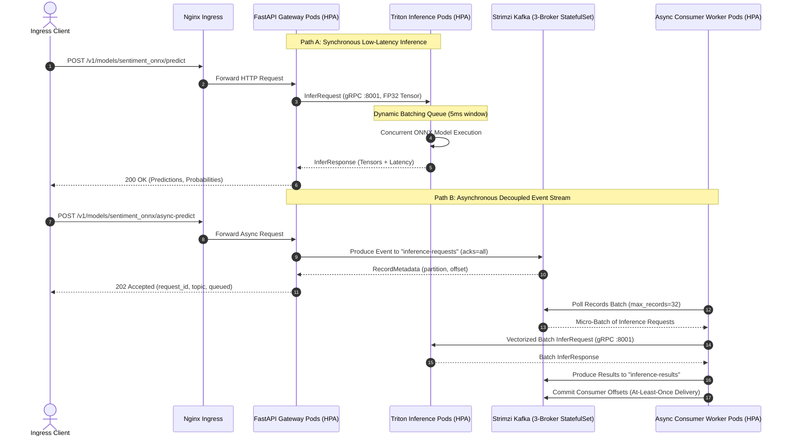

# KubeScale AI: Cloud-Native Infrastructure & Scalable ML Serving

[](.github/workflows/terraform-ci.yml)
[](.github/workflows/helm-lint-deploy.yml)
[](https://kubernetes.io/)
[](https://github.com/triton-inference-server/server)
[](https://strimzi.io/)
[](https://fastapi.tiangolo.com/)

---

## 1. Executive Summary & Problem Statement

Mid-market companies frequently run mission-critical machine learning and event-processing workloads within single-host `docker-compose.yml` environments. While simple to deploy initially, this paradigm exhibits critical architectural deficiencies when scaled:

* **Single Points of Failure (SPOF):** Process death or node hardware faults bring down the entire inference stack with zero self-healing or failover.
* **Inference Head-of-Line (HoL) Blocking:** Web APIs and CPU/GPU-intensive model execution share single-host runtimes and thread pools, introducing Python GIL lock contention and catastrophic latency degradation during traffic spikes.
* **Manual Scalability Bottlenecks:** Lack of dynamic compute elasticity means engineering teams must either over-provision idle cloud VMs (high cost) or suffer outages during sudden demand surges.
* **Infrastructure Drift:** Cloud environments configured via manual web console clicks rather than immutable, version-controlled Infrastructure as Code (IaC).

**KubeScale AI** re-architects this stack into an enterprise-ready, cloud-native ML serving and streaming platform powered by **Amazon EKS (Terraform)**, **Triton Inference Server**, **Strimzi Kafka Operator**, **FastAPI**, and **Horizontal Pod Autoscaling (HPA)**.

---

## 2. System Architecture

```
 ┌────────────────────────────────────────────────────────────────────────┐
 │                      Terraform Cloud / Local IaC                       │
 │  - Custom VPC (3 AZs), Public/Private Subnets, NAT Gateways, EKS v1.30 │
 │  - S3 + DynamoDB Remote State Locking, Least-Privilege OIDC & IRSA     │
 └───────────────────────────────────┬────────────────────────────────────┘
                                     │
                                     ▼
 ┌────────────────────────────────────────────────────────────────────────┐
 │                       Kubernetes Cluster Runtime                       │
 │                                                                        │
 │   [ Ingress-Nginx Controller + Cert-Manager (TLS Termination) ]        │
 │                                   │                                    │
 │          ┌────────────────────────┴───────────────────────┐            │
 │          ▼                                               ▼            │
 │   ┌───────────────────────────┐          ┌──────────────────────────┐  │
 │   │ FastAPI Gateway (HPA)     │  gRPC    │ Triton / ONNX Pods (HPA) │  │
 │   │ - Deployment (2-10 Pods)  │─────────►│ - Dynamic Batching       │  │
 │   │ - ConfigMap & K8s Secrets │  (8001)  │ - Model Repo (S3 / PVC)  │  │
 │   │ - Rolling Zero-Downtime   │          │ - Multi-Instance Workers │  │
 │   └─────────────┬─────────────┘          └─────────────▲────────────┘  │
 │                 │                                      │               │
 │                 │ Event Stream (Kafka Producer)        │ gRPC Batch    │
 │                 ▼                                      │ (8001)        │
 │   ┌───────────────────────────┐          ┌─────────────┴────────────┐  │
 │   │ Strimzi Kafka Operator    │          │ Async Worker Pods (HPA)  │  │
 │   │ - 3-Broker StatefulSet    │─────────►│ - Consumer Micro-Batch   │  │
 │   │ - Dynamic PVC Storage     │ (events) │ - Offset Commit Guarantees│ │
 │   │ - Zero Message Loss (ISR) │◄─────────│ - Writes to Result Topic │  │
 │   └───────────────────────────┘ (results)└──────────────────────────┘  │
 └────────────────────────────────────────────────────────────────────────┘
```

### Architectural Sequence Flow



---

## 3. Scope Deliverables & Technical Modules

### Module 1: Infrastructure as Code (`/terraform`)
* **Network & Compute Topology:** Declarative HCL templates defining a 3-AZ VPC, public/private subnets, internet & NAT gateways, and an Amazon EKS cluster running Kubernetes 1.30.
* **State Locking & Isolation:** S3 remote state backend with DynamoDB table state locking (`kubescale-ai-tflocks`) to prevent concurrent race conditions.
* **Least-Privilege IAM (IRSA):** AWS IAM Roles for Service Accounts allows Triton inference pods to securely read model weights from Amazon S3 without hardcoding static credentials into container environments.

### Module 2: Kubernetes Stateful & Stateless Workloads (`/helm`)
* **Stateful Streaming Core:** 3-node enterprise Kafka cluster provisioned by the **Strimzi Kafka Operator**, backed by `StatefulSets`, headless internal services, and dynamic `PersistentVolumeClaims (gp3)` guaranteeing zero message loss during node drain or eviction.
* **Decoupled Model Inference Service:** Dedicated **Triton Inference Server** deployment supporting dynamic batching (`max_queue_delay_microseconds: 5000`), multi-instance CPU/GPU worker queues, and gRPC internal communication over port 8001.
* **API Gateway & Microservices:** Stateless FastAPI ingress microservices configured with zero-downtime rolling upgrades (`maxSurge: 25%`, `maxUnavailable: 0`), Prometheus telemetry, and graceful lifespan connection pooling.
* **Asynchronous Inference Workers:** Dedicated Kafka consumer workers (`worker/`) implementing micro-batching, gRPC Triton execution, and reliable offset commit management.
* **Cluster Configuration:** Parameterized via `ConfigMaps` and sealed/base64 `Secrets`.

### Module 3: Elasticity & Self-Healing
* **Horizontal Pod Autoscaling (HPA):** Dynamically scales FastAPI gateway, Triton worker, and Kafka consumer pods between **2 and 10 replicas** based on CPU/Memory saturation and traffic volume.
* **Resilience Probes:** Granular `readinessProbe` (preventing early traffic delivery before models load) and `livenessProbe` (automatic pod reboot upon deadlock), plus `startupProbe` to handle slow model initializations.
* **Resource Quotas & Limits:** Enforced CPU and Memory `requests` and `limits` to guard against noisy neighbors and memory thrashing.
* **PodDisruptionBudgets (PDB):** Guarantees high availability during Kubernetes cluster upgrades and node scale-down operations.

### Module 4: Packaging & Delivery (`/helm` & `.github/workflows`)
* **Custom Helm Package:** Fully parameterized chart (`Chart.yaml`, `values.yaml`, `values-prod.yaml`, and modular templates).
* **Automated CI/CD:** GitHub Actions workflows running `terraform fmt`, `terraform validate`, `tflint`, `helm lint`, container builds, and security scans.

---

## 4. Repository File Structure

```text
kubescale-ai/
├── .github/
│   └── workflows/
│       ├── terraform-ci.yml           # Terraform fmt, init, validate, tflint, security
│       └── helm-lint-deploy.yml       # Helm lint, template verification, pytest, docker build
├── terraform/
│   ├── main.tf                        # Provider setup & remote backend declaration
│   ├── variables.tf                   # Parameterized VPC, EKS, and IRSA settings
│   ├── outputs.tf                     # Cluster endpoints, subnet IDs, and IRSA ARNs
│   ├── vpc.tf                         # Multi-AZ VPC, subnets, NAT Gateways & route tables
│   ├── eks.tf                         # EKS Cluster, managed node groups & add-ons
│   ├── iam.tf                         # OIDC Identity Provider & IRSA role for S3 access
│   └── terraform.tfvars.example       # Example variable inputs
├── helm/
│   └── kubescale/
│       ├── Chart.yaml                 # Helm v2 package metadata
│       ├── values.yaml                # Development & local environment defaults
│       ├── values-prod.yaml           # Production environment overrides (TLS, replicas, IRSA)
│       └── templates/
│           ├── _helpers.tpl           # Template naming & selector helpers
│           ├── gateway-deployment.yaml# FastAPI stateless deployment with rolling updates
│           ├── gateway-service.yaml   # ClusterIP service for API Gateway
│           ├── worker-deployment.yaml # Async Kafka consumer worker deployment
│           ├── worker-service.yaml    # Telemetry and health service for worker pods
│           ├── inference-deployment.yaml # Triton server deployment with dynamic batching
│           ├── inference-service.yaml # Multi-port service (HTTP 8000, gRPC 8001, Metrics 8002)
│           ├── inference-serviceaccount.yaml # ServiceAccount annotated with IRSA role ARN
│           ├── kafka-cluster.yaml     # Strimzi Kafka 3-broker StatefulSet & KafkaTopics
│           ├── hpa.yaml               # Horizontal Pod Autoscalers (2-10 replicas)
│           ├── ingress.yaml           # Ingress-Nginx routing with cert-manager annotations
│           ├── configmap.yaml         # Cluster configuration keys
│           ├── model-configmap.yaml   # Triton config.pbtxt configuration
│           ├── pdb.yaml               # PodDisruptionBudget for rolling availability
│           └── secrets.yaml           # Base64 cluster secrets
├── gateway/
│   ├── Dockerfile                     # Multi-stage secure non-root container build
│   ├── requirements.txt               # FastAPI, Triton gRPC, Kafka, and Prometheus
│   ├── app/
│   │   ├── __init__.py
│   │   ├── config.py                  # Pydantic BaseSettings environment loader
│   │   ├── schemas.py                 # Request/Response models for inference & Kafka events
│   │   ├── triton_client.py           # Async non-blocking gRPC Triton client wrapper
│   │   ├── kafka_producer.py          # Resilient Kafka producer with circuit breaking
│   │   └── main.py                    # FastAPI application with probes and Prometheus metrics
│   └── tests/
│       ├── __init__.py
│       └── test_api.py                # Unit & integration test suite
├── worker/
│   ├── Dockerfile                     # Multi-stage secure non-root container build
│   ├── requirements.txt               # Kafka consumer, Triton gRPC, and Prometheus
│   ├── app/
│   │   ├── __init__.py
│   │   ├── config.py                  # Consumer and batching settings
│   │   └── consumer.py                # Micro-batching Kafka consumer loop
│   └── tests/
│       ├── __init__.py
│       └── test_worker.py             # Worker micro-batching unit tests
├── models/
│   ├── sentiment_onnx/
│   │   ├── config.pbtxt               # Triton model configuration (dynamic batching)
│   │   └── 1/                         # Model version 1 directory
│   │       └── model.onnx             # Model binary
│   └── scripts/
│       └── generate_dummy_model.py    # Generates a valid ONNX model for testing
├── scripts/
│   ├── setup_local_cluster.sh         # Local hybrid bootstrap (Kind / Minikube)
│   └── load_test.py                   # High-throughput load generator for HPA verification
├── Makefile                           # Unified automation CLI
├── .gitignore
├── .dockerignore
└── README.md
```

---

## 5. Quick Start & Execution Guide

### Option A: Local Development (FastAPI + Mock/Test)

```bash
# 1. Initialize virtual environment and install dependencies
make init
source .venv/bin/activate

# 2. Run unit and integration tests
make test

# 3. Build Docker container image
make docker-build
```

### Option B: Local Kubernetes Deployment (Kind / Minikube)

```bash
# Bootstrap local cluster, Strimzi operator, and deploy KubeScale Helm chart
make cluster-local

# Verify running pods
kubectl get pods -n kubescale

# Verify HPA configuration (2-10 replicas)
kubectl get hpa -n kubescale

# Port-forward API Gateway to localhost:8000
kubectl port-forward svc/kubescale-gateway 8000:8000 -n kubescale
```

### Option C: Production AWS EKS Deployment (Terraform)

```bash
cd terraform

# 1. Copy and customize configuration
cp terraform.tfvars.example terraform.tfvars

# 2. Initialize Terraform providers and backend
terraform init

# 3. Review infrastructure execution plan
terraform plan

# 4. Provision VPC, EKS Cluster, and IRSA IAM roles
terraform apply

# 5. Connect local kubectl to newly provisioned EKS cluster
$(terraform output -raw kubectl_config_command)

# 6. Deploy production Helm chart
helm upgrade --install kubescale ../helm/kubescale \
  --namespace kubescale \
  --create-namespace \
  -f ../helm/kubescale/values-prod.yaml
```

---

## 6. API Reference & Sample Payloads

### 1. Synchronous Inference (gRPC -> Triton)
**Endpoint:** `POST /v1/models/sentiment_onnx/predict`

```bash
curl -X POST http://localhost:8000/v1/models/sentiment_onnx/predict \
  -H "Content-Type: application/json" \
  -d '{
    "model_name": "sentiment_onnx",
    "inputs": [
      [0.12, 0.45, -0.23, 0.88, 0.15, -0.09, 0.72, 0.31]
    ]
  }'
```

**Response:**
```json
{
  "request_id": "8d3e5e6c-3891-4965-b74a-cfdbca20d182",
  "model_name": "sentiment_onnx",
  "model_version": "1",
  "outputs": [[0.1542, 0.8458]],
  "predictions": [1],
  "latency_ms": 3.42,
  "backend": "Triton-gRPC",
  "timestamp": 1729252000.12
}
```

### 2. Asynchronous Event-Driven Inference (Kafka Stream)
**Endpoint:** `POST /v1/models/sentiment_onnx/async-predict`

```bash
curl -X POST http://localhost:8000/v1/models/sentiment_onnx/async-predict \
  -H "Content-Type: application/json" \
  -d '{
    "model_name": "sentiment_onnx",
    "inputs": [
      [0.12, 0.45, -0.23, 0.88, 0.15, -0.09, 0.72, 0.31]
    ],
    "callback_topic": "inference-results"
  }'
```

**Response:**
```json
{
  "request_id": "f5b678de-a5d6-4467-8854-159eecf605a9",
  "status": "QUEUED",
  "topic": "inference-requests",
  "partition": 2,
  "offset": 45102,
  "message": "Inference job successfully published to Kafka topic for stream processing.",
  "timestamp": 1729252001.45
}
```

### 3. Liveness and Readiness Probes
```bash
# Liveness probe (checks process state)
curl http://localhost:8000/healthz

# Readiness probe (checks backend Triton connectivity)
curl http://localhost:8000/readyz

# Prometheus metrics scrape endpoint
curl http://localhost:8000/metrics
```

---

## 7. Elasticity Testing & Autoscaling (HPA & KEDA)

### Standard Resource Autoscaling (CPU / Memory HPA)
Simulate sudden production traffic bursts to trigger the Horizontal Pod Autoscaler scaling pods from 2 to 10:

```bash
# Launch concurrent load test (500 requests, 25 worker threads)
make load-test

# Monitor dynamic cluster auto-scaling in real-time
kubectl get hpa -n kubescale -w
kubectl get pods -n kubescale -l app.kubernetes.io/name=kubescale -w
```

### Proactive Event-Driven Autoscaling (KEDA)
When traffic surges occur asynchronously over Kafka, standard CPU-based HPA can lag behind message volume. **KEDA** scales the worker pods based on **Kafka consumer group lag** (`records-lag-max > 50`) and Triton pods based on **queue wait duration**:

```bash
# 1. Install KEDA Operator
make keda-install

# 2. Inspect active KEDA ScaledObjects
kubectl get scaledobject -n kubescale

# 3. Observe worker pods scaling from 1/2 up to 20 replicas as Kafka queue fills
kubectl get pods -n kubescale -l app.kubernetes.io/component=worker -w
```

---

## 8. Deep Observability & Curated Grafana Dashboards

KubeScale AI includes Prometheus Operator integration via `ServiceMonitors`, production alerting rules, and curated Grafana dashboards:

### Dashboards Included:
1. **Platform Overview & SLIs (`monitoring/dashboards/kubescale-overview.json`):** Gateway RPS, HTTP 2xx/4xx/5xx status distribution, P50/P90/P95/P99 latency percentiles, Triton mean inference duration, and active HPA/KEDA pod replicas.
2. **Triton ML Serving Deep-Dive (`monitoring/dashboards/triton-inference.json`):** Inference throughput per model, dynamic batch queue wait time vs. compute execution duration, and model failure rates.
3. **Kafka Streaming & Worker Pipeline (`monitoring/dashboards/kafka-streaming.json`):** Gateway event publish rate, worker consumption rate, consumer lag per partition, and micro-batch size distributions.

### Alerting Rules (`monitoring/rules/kubescale-prometheus-rules.yaml`):
* `GatewayHighLatency`: Fires when P99 request latency exceeds 500ms for 3 minutes.
* `GatewayCriticalErrorRate`: Fires when 5xx HTTP errors exceed 5% of traffic.
* `TritonQueueStall`: Fires when Triton dynamic batch queue wait exceeds 20ms.
* `KafkaConsumerLagElevated`: Fires when consumer lag on `inference-requests` exceeds 500 messages.
* `AsyncInferenceWorkerDown`: Critical alert when zero worker pods are available to process traffic.

### Quick Start Monitoring:
```bash
# 1. Deploy Prometheus Operator, Alertmanager, Grafana, and import dashboards
make monitoring-install

# 2. Forward Grafana port to localhost:3000
kubectl port-forward svc/prometheus-stack-grafana 3000:80 -n monitoring
# Access: http://localhost:3000 (User: admin / Password: prom-operator)
```

---

## 9. Continuous Integration & Quality Assurance

| Pipeline | Trigger | Checks Executed |
|:---|:---|:---|
| **Terraform CI** | Push/PR in `/terraform` | `terraform fmt -check`, `terraform init`, `terraform validate`, `tflint`, `trivy` |
| **Helm & Container CI** | Push/PR in `/helm`, `/gateway`, `/worker` | `helm lint` (dev & prod values), `helm template`, Python unit tests (`pytest`), Docker container builds |


Run all validations locally:
```bash
make tf-fmt
make tf-validate
make helm-lint
make helm-template
make test
```

---

## 9. License

This project is licensed under the Apache 2.0 License.
